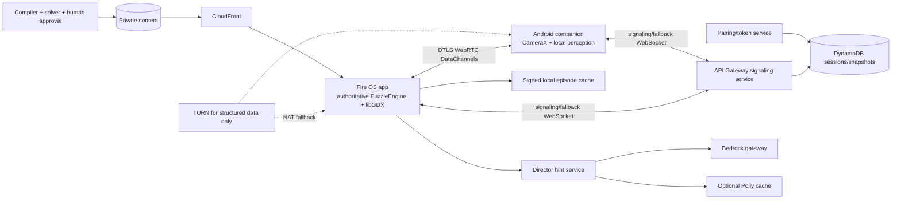

# RoomSmith — Implementation Specification

**Specification version:** 1.0.0
**Primary track:** Fire TV
**Project status:** ready for implementation; no code is implied
**Dependencies:** [SHARED_ENGINEERING_STANDARD.md](./specs/SHARED_ENGINEERING_STANDARD.md), [puzzle-graph.schema.json](./schemas/puzzle-graph.schema.json)
**Validated draft example:** [puzzle-graph.example.json](./examples/puzzle-graph.example.json)

## 1. Product contract

RoomSmith is a cooperative Fire OS escape-room game in which players arrange household objects or perform hand gestures, an Android companion converts camera frames into local structured observations, and a deterministic Fire TV puzzle engine changes the shared story.

Bedrock acts as a constrained director for approved narrative variants and hints. It cannot create puzzles at runtime, mutate solution predicates, or declare success.

The first release contains one polished 8–12 minute micro-episode, **Light the Last Lighthouse**, for one to four players ages 8+ with adult supervision for children. It includes three physical puzzles, complete remote fallbacks, solo mode, no-timing mode, captions, and reduced motion.

### 1.1 Non-goals

- Infinite generated adventures or arbitrary room scanning.
- Face, identity, emotion, age, or behavior recognition.
- Uploading living-room video or continuous audio.
- Requiring running, throwing, climbing, fine motor precision, or color-only reasoning.
- Making an unfair puzzle acceptable because an AI can give hints.
- Claiming camera reliability across all homes without the specified device/home evaluation.

## 2. Requirements

### 2.1 Functional requirements

| ID | Requirement | Priority |
| --- | --- | --- |
| FR-RS-001 | Install and run a signed/versioned episode bundle on Fire OS with remote navigation. | P0 |
| FR-RS-002 | Configure player count, object kit, accessibility, adult supervision, and privacy before play. | P0 |
| FR-RS-003 | Pair an Android companion using one-time credentials and encrypted WebRTC DataChannels; cloud-relay fallback is explicit. | P0 |
| FR-RS-004 | Calibrate the printable PlayMat and selected object kit before physical puzzles. | P0 |
| FR-RS-005 | Detect only allowlisted objects, colors, spatial relations, zones, and hand gestures on-device. | P0 |
| FR-RS-006 | Emit candidate and stable structured observations with confidence, sequence, and calibration state; never emit frames. | P0 |
| FR-RS-007 | Evaluate puzzle requirements deterministically on Fire TV using hold-to-verify and temporal hysteresis. | P0 |
| FR-RS-008 | Complete the three authored puzzles and corresponding scene transitions without model participation. | P0 |
| FR-RS-009 | Provide role-based clues and a complete solo path. | P0 |
| FR-RS-010 | Provide equivalent remote fallbacks, no-timing mode, non-color labels, captions, and reduced motion. | P0 |
| FR-RS-011 | Supply authored hints and optional schema-bounded Bedrock director hints with deterministic fallback. | P0 |
| FR-RS-012 | Recover from disconnect/process restart using committed state and reject stale observations. | P0 |
| FR-RS-013 | Generate a final illustrated case report from game state only, not room imagery. | P0 |
| FR-RS-014 | Publish only schema-valid, solver-verified, asset-verified, human-reviewed puzzle graphs. | P0 |
| FR-RS-015 | Delete session artifacts on request and under retention policy. | P0 |

### 2.2 Integration requirements

| ID | Requirement |
| --- | --- |
| INT-RS-001 | The complete game MUST run as an installable Fire OS app and be demonstrated on actual Fire TV hardware or the permitted simulator. |
| INT-RS-002 | CameraX, MediaPipe, and OpenCV processing MUST run locally on the Android companion; no raw frame channel exists in the backend protocol. |
| INT-RS-003 | WebRTC DataChannels provide encrypted structured observation/control transport; API Gateway WebSocket is signaling and explicit fallback. |
| INT-RS-004 | Bedrock director output passes the shared model gateway and cannot invoke game state mutations. |
| INT-RS-005 | S3/CloudFront serves signed content; the content compiler and solver run before publication. |
| INT-RS-006 | Polly audio is optional for approved director hints; all essential dialogue ships with captions and authored audio/text. |

### 2.3 Non-functional requirements

| ID | Budget/requirement |
| --- | --- |
| NFR-RS-001 | p95 stable-observation-to-scene latency below 300 ms over WebRTC on the reference LAN and below 700 ms over cloud fallback. |
| NFR-RS-002 | Scene rendering sustains 30 fps at 1080p; remote response begins within 100 ms. |
| NFR-RS-003 | Puzzle evaluation below 8 ms and never waits on network/model inference. |
| NFR-RS-004 | Zero false puzzle accepts in 1,000 scripted negative interactions per release; measured valid-setup first-attempt completion at least 95% before fallback. |
| NFR-RS-005 | Perception loss produces a recoverable calibration/fallback state within two seconds, never a false success. |
| NFR-RS-006 | Offline remote-only play works after episode download; no raw room media appears in logs, backend storage, analytics, or case reports. |

## 3. Flagship episode and game rules

### 3.1 Shared setup

Players select the available kit: red cup, blue cup, book, bottle, and spoon. Only required objects are mandatory. The printable PlayMat contains ArUco calibration markers and labeled zones `zone_lens`, `zone_archive`, and `zone_beacon`; labels include icons/text, not color alone.

The companion is fixed in a stable position. The app checks markers, glare, blur, object visibility, and hand-frame quality before each camera puzzle. No puzzle requires a particular player to use the camera.

### 3.2 Puzzle 1 — `lighthouse_alignment`

**Story:** align the red lens left of the archive book to reveal the beam path.

**Physical success requirement:**

```text
red_cup LEFT_OF book
normalized_margin = 0.05 mat widths
subject and target min_confidence = 0.70
hold_ms = 1000
```

The engine computes the relation from mat-normalized bounding boxes. Candidate observations animate only a subtle targeting indicator; the lighthouse activates only after stable success.

**Remote fallback:** choose the illustrated arrangement that places the red lens left of the book. Options also include text labels.

### 3.3 Puzzle 2 — `raise_the_shield`

**Story:** send an open-palm signal to raise the shield while the navigator reads the clue.

**Physical success requirement:** one `open_palm` gesture with min confidence 0.75 held 750 ms. Face detection is neither required nor enabled. The tracker uses hand landmarks only.

**Remote fallback:** hold a large remote-selected shield button for 750 ms; no-timing mode replaces the hold with a single selection.

### 3.4 Puzzle 3 — `lens_archive_sequence`

**Story:** place the blue lens in `zone_lens`, then archive the book in `zone_archive`.

**Physical success requirement:** ordered sequence within 30 seconds:

1. `blue_cup INSIDE_ZONE zone_lens`, at least 60% bounding-box overlap, hold 500 ms;
2. `book INSIDE_ZONE zone_archive`, at least 60% overlap, hold 500 ms.

The sequence timer starts after step 1. No-timing mode removes the 30-second interval but preserves order. A wrong-order stable observation gives a neutral reset hint, not a punishment.

**Remote fallback:** order the two labeled actions using remote controls.

### 3.4 Completion

The TV renders the restored lighthouse and generates a case report containing episode version, puzzle completion paths (`camera` or `remote`), hints used, and elapsed active time. It contains no detected object image, player name, room snapshot, or hand imagery.

## 4. Canonical graph and deterministic engine

The normative content contract is [puzzle-graph.schema.json](./schemas/puzzle-graph.schema.json).

### 4.1 Runtime state

```text
session_id, episode_id, content_version, graph_sha256
node_id, state_sequence, player_count, roles
accessibility_settings, object_kit, play_mat_version
puzzle_id, attempt_count, hint_level, puzzle_started_at
candidate_observation_id, stable_observation_ids
sequence_step, sequence_started_at
completed_puzzles[{puzzle_id, path, completed_at}]
status: setup | playing | awaiting_observation | verifying | fallback | completed
```

Only the Fire TV `PuzzleEngine` can append committed state. Companion observations are proposals. Director text, renderer animations, and backend snapshots cannot advance state.

### 4.2 Stable observation rule

An observation becomes eligible when:

- it belongs to current session, puzzle, camera calibration, and object-kit version;
- all required predicates meet min confidence and spatial thresholds;
- the same stable condition persists for `hold_ms`, allowing at most one missing candidate frame;
- its frame/observation sequence is newer than the last committed observation;
- no `needs_review`, calibration loss, or occlusion flag is active.

On success, the engine records stable observation IDs once and emits a `PuzzleCompleted` event. Further observations for that puzzle are ignored.

### 4.3 Publisher solver

The content compiler MUST:

- validate JSON Schema, unique IDs, references, assets, captions, and human approvals;
- topologically verify all required scenes/puzzles are reachable and every branch has a default;
- enumerate camera and remote paths, solo/multiplayer, no-timing, and each allowed object-kit subset;
- solve every remote fallback and verify correct option IDs;
- type-check every predicate against object/zone/gesture registries;
- ensure hint ladders do not contradict the current solution or reveal it before the allowed level;
- reject unsafe actions/materials and camera-only completion paths;
- sign the immutable bundle and record graph SHA-256.

## 5. Reference architecture



### 5.1 Transport decisions

- `observations` DataChannel: unordered, `maxRetransmits=0`, candidate updates at 5 Hz; stale candidates may be dropped.
- `control` DataChannel: reliable ordered; stable observations, fallback selections, state snapshots, and completion messages.
- WebRTC DTLS encrypts both. No RTP audio/video tracks or `getUserMedia` permissions are created on the TV.
- API Gateway WebSocket fallback carries the same JSON contracts and marks `transport=cloud_relay`.
- TURN relays structured JSON only when direct connectivity fails. TURN credentials are short-lived and session-scoped.
- If all transports fail, TV offers remote-only play; it never relaxes puzzle predicates to force success.

## 6. Required repository layout

```text
roomsmith/
  apps/
    firetv/                       # Kotlin Leanback + libGDX + PuzzleEngine coordinator
    companion/                    # Kotlin CameraX + perception + WebRTC client
  services/
    pairing/                      # One-time codes, device credentials, revocation
    signaling/                    # WebRTC offers/answers/ICE + cloud fallback
    director/                     # Bedrock/Polly bounded hints
    content/                      # Signed manifests and distribution
  packages/
    puzzle-engine/                # Pure Kotlin deterministic state and predicates
    perception/                   # Android detectors, mat calibration, trackers
    session-contracts/            # Kotlin/TypeScript generated messages
    content-compiler/             # TypeScript schema/solver/signing pipeline
    scene-parameters/             # Versioned renderer command registry
    model-gateway/
    testkit/
  content/
    episodes/light-the-last-lighthouse/
      episode.json
      scenes.json
      dialogue.json
      hints.json
      assets/
      play-mat.pdf
      reviews.json
  infra/
    turn/                         # Optional coturn configuration and tests
  tests/
  docs/
  evidence/
```

## 7. Pairing, transport, and session contracts

### 7.1 REST endpoints

| Method/path | Behavior |
| --- | --- |
| `POST /v1/sessions` | TV creates session and short-lived pairing material |
| `POST /v1/pairings/exchange` | Companion exchanges one-time code + nonce for scoped device credential |
| `POST /v1/sessions/{id}/webrtc/offer` | Exchange SDP offer through authenticated signaling |
| `POST /v1/sessions/{id}/webrtc/answer` | Exchange SDP answer |
| `POST /v1/sessions/{id}/webrtc/ice` | Exchange bounded ICE candidate |
| `POST /v1/sessions/{id}/turn-credentials` | Issue short-lived structured-data TURN credentials |
| `GET /v1/sessions/{id}` | Resume committed snapshot |
| `DELETE /v1/sessions/{id}/pairing` | Revoke companion and TURN/session credentials |
| `DELETE /v1/sessions/{id}` | Delete session/hint artifacts |
| `GET /v1/episodes/{id}/manifest` | Signed content manifest |
| `POST /v1/director/hints` | Validated hint or authored fallback |

SDP/ICE payloads are size-limited, validated, session-bound, and never logged in full. Pairing codes expire in five minutes and are single-use.

### 7.2 Message envelope

```json
{
  "schema_version": 1,
  "message_id": "01J...",
  "session_id": "01J...",
  "device_id": "01J...",
  "sequence": 42,
  "sent_at": "2026-10-23T12:00:00.000Z",
  "type": "observation.stable",
  "payload": {}
}
```

Maximum message size is 8 KB. Types:

| Type | Sender | Payload/behavior |
| --- | --- | --- |
| `session.hello` | either | auth context, last acknowledged sequence |
| `calibration.state` | companion | mat version, marker/quality codes, object-kit version |
| `observation.candidate` | companion | current puzzle, predicates/confidences, frame sequence; transient |
| `observation.stable` | companion | stable predicate set, observation IDs, calibration version; engine still verifies hold/current state |
| `observation.invalid` | companion | occlusion/calibration/quality change; cancels candidate verification |
| `puzzle.verify` | TV | local hold progress, not external success |
| `puzzle.complete` | TV | committed puzzle/path/sequence; idempotent |
| `fallback.commit` | TV | accessible fallback result and expected state sequence |
| `state.snapshot` | TV | committed state and scene command metadata |
| `director.context` | TV | current node, attempts, hint level, coarse errors only |
| `session.error` | either | typed recoverable error |
| `session.revoke` | TV/backend | closes channels and deletes credentials |

The companion MUST NOT send `puzzle.complete`; receivers reject it.

## 8. Companion perception specification

### 8.1 Pipeline

1. CameraX provides 1280×720 frames at target 15 fps to in-memory analyzers.
2. OpenCV ArUco detects PlayMat markers and computes mat homography. Calibration fails on missing markers, reprojection error >8 pixels, or inadequate mat area.
3. MediaPipe Object Detector using the pinned EfficientDet-Lite model detects COCO classes `cup`, `book`, `bottle`, and `spoon`.
4. A centroid/IoU tracker maintains object IDs; detector runs on demand for the active puzzle, not continuously in menus.
5. Cup color is classified from HSV pixels inside the central detection region after white-balance calibration. `red`, `blue`, and `unknown` are the only outputs; unknown cannot satisfy a color requirement.
6. Spatial predicates use mat-normalized bounding boxes. `left_of` requires subject center plus the configured normalized margin to remain left of target center. `inside_zone` requires at least the configured bbox/polygon overlap.
7. MediaPipe Hands produces 21 landmarks for `open_palm`; a deterministic finger-extension rule and temporal smoothing produce gesture confidence. No face detector is initialized.
8. Candidate/stable/invalid messages follow the engine contracts. Frame and landmark buffers are reused and never persisted by application code.

### 8.2 Calibration and failure UX

The companion shows a local debug view only during adult-led setup; normal play uses simple quality icons/text. The TV displays actionable states: “Move the phone to show all four markers,” “Cup color unclear—use the labeled cup or remote path,” and “Camera unavailable—continue with remote.”

The app MUST NOT instruct players to change unsafe lighting, climb, move furniture dangerously, or hold a pose that excludes them. Every camera failure has a remote recovery within two remote actions from the puzzle screen.

## 9. Fire TV game and director design

### 9.1 Modules

- **Leanback UI:** setup, accessibility, pairing, puzzles, fallback, privacy, case report.
- **PuzzleEngine:** pure Kotlin deterministic state machine, predicate evaluation, hold timers with injected clock, sequence/recovery logic.
- **Scene renderer:** libGDX and versioned `SceneCommandRegistry`; only authored scene IDs and numeric/enumerated parameters.
- **Transport:** WebRTC and cloud fallback with common session contracts and revocation.
- **Content store:** signed bundle verification, encrypted app-private storage, two-version rollback.
- **Director client:** asynchronous hints; puzzle engine continues independently.

### 9.2 Director operation

`director_hint.v1` input:

```json
{
  "episode_version": "1.0.0",
  "puzzle_id": "lighthouse_alignment",
  "attempt_count": 2,
  "hint_level": 1,
  "last_error": "color_unknown",
  "transport": "webrtc",
  "accessibility_mode": "standard"
}
```

Output:

```json
{
  "text": "Check the lens label, then compare its position with the book.",
  "hint_level": 1,
  "target_role": "observer",
  "uses_fallback": false
}
```

Validation requires 5–45 words, current-puzzle relevance, allowed role, no new objects/actions, no emotion/identity comments, and no solution reveal beyond the authored hint at the same level. Bedrock timeout, malformed output, safety rejection, or excessive latency returns the authored hint immediately.

The director may select among preauthored dialogue variants using a deterministic seed and context. It cannot add/remove graph nodes or alter timing/predicates.

## 10. UX and accessibility

Screens:

1. Welcome and episode continue/new.
2. Adult/privacy setup and player count.
3. Accessibility: no timing, reduced motion, captions, remote-only, larger text.
4. Object-kit selection with illustrations/text.
5. Companion pairing/calibration or remote-only.
6. Story/puzzle with public clue and current role.
7. Verification progress that does not flicker with every frame.
8. Fallback chooser always reachable within two actions.
9. Completion/case report and replay.

Requirements:

- Complete game with remote only, solo, no timing, and without speech.
- Captions and text equivalents for every audio clue; audio description for essential scene action.
- Status is never color-only; red/blue objects also have printed labels available in the kit guide.
- Reduced motion removes camera sweeps/flashes; no flashing above accessibility thresholds.
- Focus order, 10-foot readability, 200% text scaling where supported, and screen-reader labels are tested.
- No public leaderboard, child account, advertising, or pressure timer in no-timing mode.

## 11. Security and privacy

| ID | Requirement |
| --- | --- |
| SEC-RS-001 | Raw frames, hand landmarks, room images, and continuous audio never leave the companion; protocols reject media fields/tracks. |
| SEC-RS-002 | Pairing/signaling/TURN credentials are one-session, short-lived, revocable, and device-bound. |
| SEC-RS-003 | Companion cannot commit puzzle state; TV validates session, puzzle, calibration, freshness, and hold. |
| SEC-RS-004 | Signed content and predicate registries prevent malicious bundles or generated solution changes. |
| SEC-RS-005 | Session snapshots and director context delete after seven days; case reports contain game metadata only. |
| SEC-RS-006 | No face/emotion/identity/age inference, behavioral advertising, or training on room media. |
| SEC-RS-007 | SDP/ICE/access tokens are redacted from logs; SDP/ICE endpoints are rate-limited and schema-validated. |
| SEC-RS-008 | A lost/revoked companion cannot reconnect or receive prior private clues without new adult approval. |

Threat tests include pairing brute force, SDP/ICE injection, WebRTC track negotiation abuse, forged stable observations, replayed sequences, revoked-device reconnect, malicious content, model prompt injection, and attempted media upload through JSON.

## 12. Observability and evaluation

Safe metrics:

- pairing/signaling/WebRTC/TURN/fallback connection success and latency;
- calibration failure codes and recovery time;
- candidate/stable observation confidence and predicate type;
- false accept/reject in labeled tests;
- observation-to-scene latency and renderer frame rate;
- puzzle attempts, hint level/fallback, camera vs remote path;
- disconnect/resume and duplicate prevention;
- content/schema/solver failures;
- crash/ANR and session deletion.

No metric includes object images, hand landmarks, free-form player names, room layout, SDP/ICE, or director input beyond coarse puzzle/error codes.

## 13. Test and acceptance matrix

### 13.1 P0 acceptance scenarios

| ID | Scenario and expected result |
| --- | --- |
| AC-RS-001 | Given modified/unsigned content, when launching, then bundle is rejected and previous signed version remains. |
| AC-RS-002 | Given consumed/expired pairing material, when exchanged, then no companion credential is issued. |
| AC-RS-003 | Given real companion/TV, when negotiating, then encrypted DataChannels connect without media tracks. |
| AC-RS-004 | Given direct WebRTC failure, when fallback activates, then cloud relay is labeled and structured game continues. |
| AC-RS-005 | Given missing mat markers/poor calibration, when observing, then no stable observation becomes eligible. |
| AC-RS-006 | Given red cup left of book for less than one second, when evaluating, then puzzle remains incomplete. |
| AC-RS-007 | Given red cup left of book stably for one second, when evaluating, then exactly one completion/scene transition occurs. |
| AC-RS-008 | Given red cup right of book or unknown color, when evaluating, then no success occurs. |
| AC-RS-009 | Given an open palm below confidence/hold threshold, when evaluating, then shield remains closed. |
| AC-RS-010 | Given valid open palm, when evaluating, then shield puzzle completes once without face processing. |
| AC-RS-011 | Given sequence step 2 before step 1, when evaluating, then sequence does not complete and neutral guidance appears. |
| AC-RS-012 | Given valid ordered steps within 30 seconds, when evaluating, then final puzzle completes once. |
| AC-RS-013 | Given no-timing mode, when sequence exceeds 30 seconds, then order still matters but time does not fail the player. |
| AC-RS-014 | Given camera loss during hold, when detected, then candidate verification cancels and fallback becomes available. |
| AC-RS-015 | Given any camera puzzle, when remote fallback is selected, then the same story node can complete accessibly. |
| AC-RS-016 | Given companion-sent `puzzle.complete`, when received, then TV rejects it and logs a security event without raw payload. |
| AC-RS-017 | Given duplicate/stale observations, when received, then no duplicate state transition occurs. |
| AC-RS-018 | Given process death after a completed puzzle, when resumed, then committed state/scene restores without replaying completion. |
| AC-RS-019 | Given Bedrock failure, when hint is requested, then authored hint arrives within budget and puzzle state is unchanged. |
| AC-RS-020 | Given revoked companion, when reconnecting, then access/private clues are denied until new approval. |
| AC-RS-021 | Given offline mode after content download, when playing remote-only, then all three puzzles and case report complete. |
| AC-RS-022 | Given actual Fire TV device/simulator, when demo runs, then real companion observations deterministically change the live episode. |

### 13.2 Engine and content tests

- Unit-test every predicate at threshold boundaries, missing target, unknown color, NaN/infinite coordinates, stale calibration, and out-of-order frames.
- Property-test that no sequence completes without required ordered stable observations or valid remote fallback.
- Enumerate all graph paths under solo/multiplayer, camera/remote, standard/no-timing, and allowed object kits.
- Soak-test 10,000 candidate observations per puzzle and verify one completion and bounded memory.

### 13.3 Perception/device evaluation

Test at least 20 physical setups across reference Fire TV devices and Android phones, five lighting conditions, three camera angles, supported skin tones for hands, object variants, clutter, occlusion, and network impairment.

Report false accepts over scripted negative interactions, valid-setup completion, calibration recovery, per-predicate confusion, and p50/p95/p99 latency. The 1,000-negative gate is a release test, not a claim of universal accuracy. Compare against a human moderator and the remote fallback.

## 14. Infrastructure and deployment

CDK provisions:

- API Gateway REST/WebSocket signaling, Lambda pairing/signaling/director/content handlers, DynamoDB session/snapshot tables with TTL;
- private S3 content/hint-audio buckets and CloudFront signed distribution;
- Cognito or scoped anonymous device token issuer, KMS, Secrets Manager;
- optional separately secured coturn EC2/Auto Scaling configuration with restricted ports, ephemeral credentials, structured-data firewall rules, and cost alarms;
- CloudWatch dashboards/alarms and content-approval deployment gates.

Fire OS/companion signing and release tracks are separate. Debug builds cannot use production content/signaling. TURN is not required for remote-only offline mode and is never used for video/audio.

## 15. Implementation slices

### Slice 0 — real device and transport skeleton

- Fire OS scene/remote app, companion camera, pairing, WebRTC structured ping, cloud fallback, signed content shell.

**Gate:** actual Fire TV + companion exchange real structured messages without media tracks.

### Slice 1 — deterministic game and remote path

- Canonical graph/compiler/solver, PuzzleEngine, all three puzzles, scenes, remote fallbacks, solo/no-timing, resume.

**Gate:** AC-RS-001, 011–015, 017–019, 021 with fixture observations and full remote play.

### Slice 2 — real perception

- Mat calibration, object/color/spatial detection, hand gesture, stable observations, latency and negative tests.

**Gate:** AC-RS-002–010, 016, 020 and NFR-RS-004 on reference setup.

### Slice 3 — director, privacy, and hardening

- Bedrock/Polly hints, revocation/deletion, threat tests, device/network/perception evaluation, accessibility.

**Gate:** AC-RS-019–022, all privacy/security gates and performance budgets.

### Slice 4 — release validation

- Multi-home playtesting, human moderator comparison, content polish, clean setup, real-device demo and submission evidence.

**Gate:** all P0 scenarios, rubric at least 90, no unresolved false-accept critical issue.

## 16. Demo and validation evidence

The under-three-minute demo shows:

1. installed Fire OS game and real companion pairing;
2. real red-cup/book observation with a brief developer overlay and one-second verification;
3. lighthouse scene transition driven by the deterministic engine;
4. open-palm and ordered-zone puzzles in concise clips;
5. one detection failure with remote recovery;
6. no-timing/remote accessibility and the imagery-free case report;
7. a short architecture overlay proving no video track leaves the phone.

Negative/failure clips must be from real runs. Do not splice a scripted detection overlay or call Bedrock the puzzle solver.

Validation compares against a human game moderator across homes. Report puzzle completion, false accept/reject, calibration time, hint appropriateness, participation balance, fallback use, latency, and crash-free sessions.

## Optional mini-challenge artifacts

These are optional and MUST NOT put cloud inference into the puzzle-critical path.

- **AWS Builder:** submit the running signed-content/solver pipeline, WebRTC signaling/fallback, constrained Bedrock director, and measured latency/reliability/cost evidence.
- **Open Source:** publish a separate `physical-puzzle-graph` project containing the schema, deterministic reference engine, observation simulator, predicate/solver test suite, and synthetic sample episode. Include its own license, tests, documentation, and release artifacts.

Do not publish room video, hand-landmark datasets, player recordings, or private session data. Adding a license to the main app alone does not satisfy the Open Source mini challenge.

## 17. Completion rubric and release blockers

| Category | RoomSmith full-credit evidence |
| --- | --- |
| Functional — 25 | Complete three-puzzle episode, physical and remote paths, solo/no-timing, resume and case report |
| Platform — 15 | Real Fire OS app plus real companion/WebRTC observations in main demo |
| Architecture/reliability — 15 | Deterministic engine, signed/solved content, encrypted transport, idempotent recovery and measured latency |
| Security/privacy — 15 | No media egress, companion cannot commit, scoped pairing/TURN, revocation/deletion and threat tests |
| UX/accessibility — 10 | Polished cooperative play, complete remote/solo/no-timing/caption/reduced-motion paths |
| Testing/evaluation — 10 | All 22 P0 scenarios, threshold/property/soak tests, 20-setup perception study and negative gate |
| Docs/operations — 5 | Device/content/TURN setup, graph authoring, incident/rollback runbooks, full traceability |
| Demo/submission — 5 | Real physical-to-scene transformation under three minutes with honest fallback and product feedback |

### Non-negotiable completion gates

- Only the deterministic Fire TV engine completes puzzles; model/director/companion messages cannot force success.
- No raw room video, hand landmarks, continuous audio, or generated room imagery leaves the companion.
- Every camera/gesture/timed puzzle has a complete accessible remote path.
- The 1,000-negative false-accept test and real multi-setup evaluation must pass before a reliability claim.
- Actual Fire OS evidence and real companion observations are mandatory for completion.
